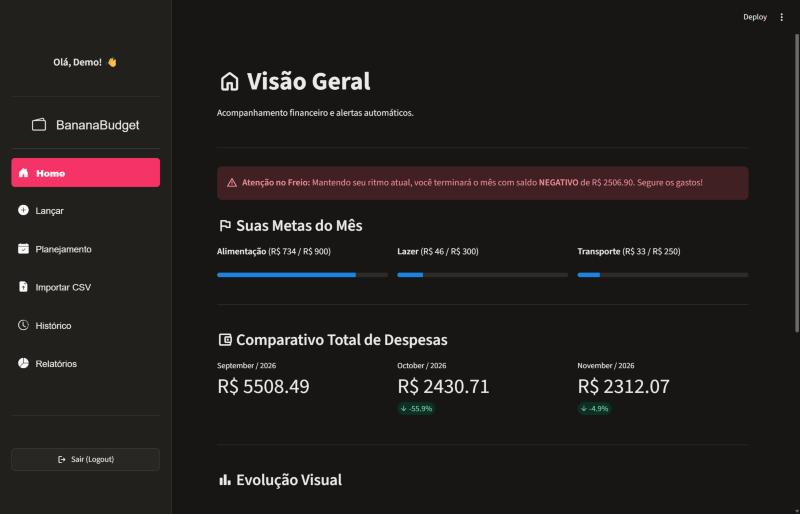

# 🍌 BananaBudget

Controle financeiro pessoal simples e direto, feito com **Python + Streamlit**.
Cada usuário tem sua conta, lança receitas e despesas (ou importa a fatura do cartão em CSV),
define metas por categoria e acompanha tudo em gráficos.




## ✨ Funcionalidades

- **Contas de usuário** com senha protegida por `bcrypt`; cada um só vê os próprios dados.
- **Visão geral (Home)**
  - Comparativo de despesas dos últimos 3 meses, com variação percentual.
  - **Projeção de fim de mês**: pelo ritmo de gasto atual, estima se o mês fecha positivo ou negativo.
  - Gráficos de receitas x despesas e de gastos por categoria.
- **Lançamento manual** de receitas e despesas.
- **Planejamento**
  - **Despesas recorrentes** (aluguel, academia, streaming…) lançadas no mês com 1 clique.
  - **Metas de gasto** por categoria, com barra de progresso e alerta perto do limite.
- **Importação de CSV** (fatura do cartão / extrato): você escolhe as colunas de data, valor e
  descrição, e o app **categoriza automaticamente** por palavras-chave.
- **Histórico** com exclusão de lançamentos.
- **Relatórios**: evolução mensal, top 10 maiores gastos e exportação para CSV.

## 🚀 Como rodar

### Com Docker (recomendado)

```bash
git clone https://github.com/carriel2/BananaBudget.git
cd BananaBudget
docker compose up -d --build
```

Acesse **http://localhost:8501**. O banco fica em `./dados/finance.db`, montado como volume,
então os dados sobrevivem a reinícios do container.

### Sem Docker

```bash
python -m venv .venv
source .venv/bin/activate      # Windows: .venv\Scripts\activate
pip install -r requirements.txt
streamlit run app.py
```

## 🏷️ Regras de categorização do CSV

O importador usa palavras-chave na descrição para escolher a categoria. Há um conjunto padrão
no código (`REGRAS_CATEGORIAS_PADRAO`). Para usar as suas sem publicá-las, crie
`dados/regras_categorias.json` (a pasta `dados/` não vai para o Git):

```json
{
  "Alimentação": ["SUPERMERCADO", "IFOOD", "PADARIA DA ESQUINA"],
  "Transporte": ["UBER", "POSTO"],
  "Assinaturas": ["NETFLIX", "SPOTIFY"]
}
```

Lançamentos negativos no CSV viram **despesa**, positivos viram **receita**, e linhas de
"Pagamento de fatura" são ignoradas.

## 🧱 Stack

| Camada | Tecnologia |
|---|---|
| Interface | Streamlit + streamlit-option-menu |
| Gráficos | Plotly Express |
| Dados | SQLite + pandas |
| Segurança | bcrypt |
| Deploy | Docker / Docker Compose |

## 📄 Licença

[MIT](LICENSE) © Pedro Carriel de Barros
